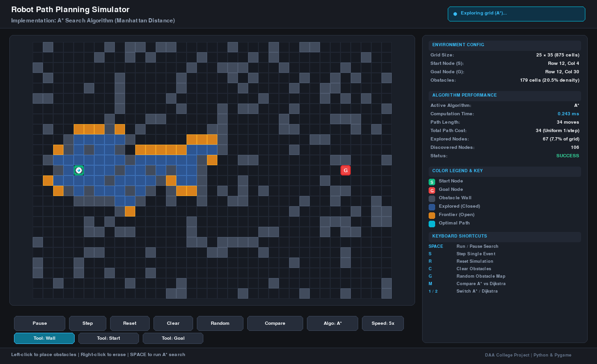
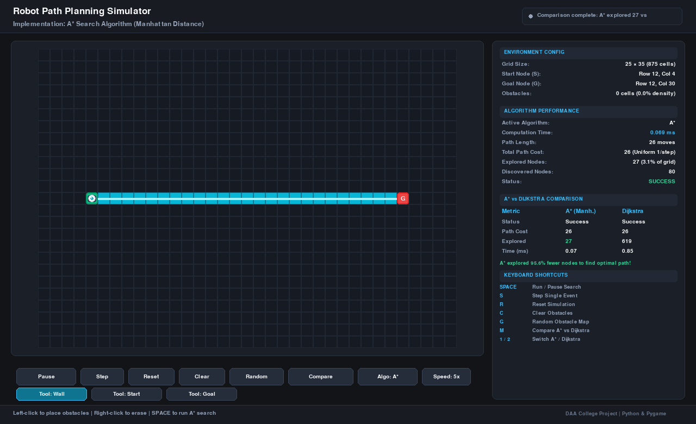

# Robot Path Planning Using the A* Search Algorithm

An interactive, dark-themed desktop and web pathfinding simulator designed for academic demonstration and algorithm analysis. Implemented in Python using Pygame and the standard library, with zero external web dependencies.

---

### GitHub Repository Information

- **Description**: An interactive, dark-themed robot path planning simulator implementing the A* search algorithm and Dijkstra comparison on 2D uniform-cost grids with animated visualization, real-time metrics, and automated tests.
- **Suggested Topics**: `python`, `pygame`, `astar-algorithm`, `pathfinding`, `robotics`, `path-planning`, `dijkstra-algorithm`, `graph-algorithms`, `algorithm-visualization`, `daa-project`, `grid-search`, `manhattan-distance`

---

## Visual Demonstration

<p align="center">
  
  <br/>
  <em>Figure 1: Real-time search exploration (Green = Start, Red = Goal, Amber = Frontier Open Set, Blue = Explored Closed Set, Cyan = Shortest Path).</em>
</p>

<p align="center">
  
  <br/>
  <em>Figure 2: Empirical comparison showing A* exploring 95.6% fewer nodes than Dijkstra ($h=0$) on the identical map while achieving identical optimal path cost.</em>
</p>

---

## 1. Project Title
**Robot Path Planning Using the A* Search Algorithm**
*College Implementation Project for Design and Analysis of Algorithms (DAA)*

---

## 2. Abstract
Path planning is a foundational problem in mobile robotics and autonomous navigation. This project presents a simulation environment that demonstrates optimal grid-based robot path planning using the A* Search Algorithm. The system features a 2D uniform-cost grid supporting dynamic obstacle placement, real-time animation of the search exploration front (open/closed sets), shortest-path reconstruction, and smooth animated robot travel. In addition to A*, the simulator includes a Dijkstra comparison mode ($h=0$), delivering empirical proof of the heuristic's efficiency in reducing node expansions while guaranteeing path optimality.

---

## 3. Problem Statement
Given a discrete 2D grid workspace containing static obstacles, a robot located at a designated starting coordinate $S = (r_s, c_s)$ must determine the shortest, obstacle-free route to a target destination $G = (r_g, c_g)$. The robot can only move along orthogonal directions (North, South, East, West) with each transition incurring a uniform cost of 1. The challenge is to efficiently explore the search space, avoid obstacle collisions, ensure minimal travel cost, and visualize both the algorithm's exploratory mechanics and the resulting robot trajectory.

---

## 4. Objectives
- **Algorithm Correctness**: Implement an independent, reusable A* engine that computes strictly optimal paths on uniform-cost 4-connected grids.
- **Heuristic Admissibility & Consistency**: Implement the Manhattan distance heuristic and verify that it never overestimates remaining costs.
- **Interactive Simulation**: Provide intuitive mouse and keyboard controls for placing/removing obstacles, repositioning start/goal endpoints, and generating randomized maps.
- **Exploration Visualization**: Visually differentiate between closed set (explored nodes), open set (frontier nodes), the optimal path, and the traversing robot.
- **Comparative Analysis**: Provide an integrated A* versus Dijkstra comparison feature to measure node expansions, search duration, and path cost.
- **Rigorous Verification**: Validate boundary conditions, edge cases, and optimality against Breadth-First Search (BFS) ground truth through automated unit tests.

---

## 5. Introduction to Robot Path Planning
In robotics, path planning involves finding a sequence of configurations that moves a robot from an initial state to a goal state without colliding with obstacles. In grid-based environment representations, the workspace is partitioned into discrete cells. A cell is either walkable or blocked by an obstacle. When a robot is constrained to orthogonal moves with uniform friction or power consumption, the workspace corresponds to an unweighted graph where every valid edge has unit weight ($c(u, v) = 1$).

---

## 6. Explanation of A*
The A* Search Algorithm (Hart, Nilsson, & Raphael, 1968) is a best-first graph search algorithm that combines Dijkstra's algorithm (uniform-cost search) with Greedy Best-First Search. By prioritizing nodes using both the cost incurred so far and an optimistic estimate of the remaining cost, A* avoids expanding nodes in directions away from the target, achieving both **completeness** (finding a path if one exists) and **optimality** (finding the shortest path).

---

## 7. Explanation of $g(n)$, $h(n)$, and $f(n)$
At each state $n$, A* evaluates the node priority function:

$$f(n) = g(n) + h(n)$$

- **$g(n)$ (Exact Path Cost)**: The cumulative actual movement cost along the known shortest path from the start node $S$ to node $n$. For uniform orthogonal steps, $g(n)$ equals the exact number of steps from start.
- **$h(n)$ (Heuristic Estimate)**: An optimistic (admissible) estimation of the cost required to travel from node $n$ to the destination $G$.
- **$f(n)$ (Estimated Total Cost)**: The estimated total cost of a complete path from $S$ through node $n$ to $G$. The priority queue always expands the node with the lowest $f(n)$. In this implementation, ties in $f(n)$ are broken by choosing the node with the smaller $h(n)$, biasing exploration along the direct line of travel.

---

## 8. Manhattan-Distance Heuristic
For a 4-directional grid where diagonal movements are disallowed and each orthogonal step has cost 1, the true shortest distance between node $(r_1, c_1)$ and node $(r_2, c_2)$ on an obstacle-free grid is the **Manhattan Distance** ($L_1$ norm):

$$h((r_1, c_1), (r_2, c_2)) = |r_1 - r_2| + |c_1 - c_2|$$

### Why Manhattan Distance is Appropriate:
1. **Admissibility**: The shortest distance between two points in a 4-connected grid without obstacles is precisely the Manhattan distance. Any obstacles present can only increase the actual distance. Thus, $h(n) \le h^*(n)$ always holds, guaranteeing optimality.
2. **Consistency (Monotonicity)**: For any neighbor $n'$ of $n$, $|h(n) - h(n')| \le 1 = c(n, n')$. The triangle inequality is satisfied, ensuring that when A* expands a node, the shortest path to that node has already been discovered, eliminating the need to re-open closed nodes.

---

## 9. System Requirements
- **Operating System**: macOS, Linux, or Windows.
- **Python**: Version 3.9+ (Python 3.9.6 verified).
- **Display**: Minimum screen resolution of $1280 \times 780$ pixels for desktop UI layout.
- **Hardware**: Standard desktop or laptop (no GPU or specialized hardware required).

---

## 10. Technology Stack
- **Language**: Python 3.9+ (utilizing dataclasses, type hints, and standard library data structures).
- **GUI & Graphics**: `pygame` (v2.6.1) for hardware-accelerated 2D surface rendering, event handling, and 60 FPS animation.
- **Web Simulation**: HTML5 Canvas, Vanilla JavaScript, and Tailwind CSS (in `index.html`).
- **Priority Queue**: Python standard library `heapq` (binary min-heap).
- **High-Resolution Timer**: Python standard library `time.perf_counter()` (monotonic nanosecond-precision timer).
- **Testing**: Python standard library `unittest`.

---

## 11. Project Directory Structure
```
robot-path-planning-astar/
├── .gitignore                  # Git exclusion rules for Python projects
├── main.py                     # Desktop application entry point & event loop
├── astar.py                    # Independent A* & Dijkstra pathfinding engine
├── grid.py                     # 2D grid state model & coordinate management
├── renderer.py                 # Pygame UI rendering, dark theme & widgets
├── index.html                  # Standalone interactive browser simulator
├── requirements.txt            # Minimal dependencies (pygame)
├── README.md                   # Comprehensive project documentation & guide
├── project_report.md           # Formal academic submission project report
├── viva_questions.md           # 18 viva voce questions & technical answers
├── presentation_outline.md     # 10-slide presentation blueprint
├── assets/                     # Real demonstration screenshots
│   ├── simulator_search_demo.png
│   └── simulator_comparison_demo.png
└── tests/
    ├── __init__.py
    └── test_astar.py           # 15 automated unit tests with BFS ground truth
```

---

## 12. Installation Instructions
1. Clone the repository:
   ```bash
   git clone <repository-url>
   cd robot-path-planning-astar
   ```
2. Activate your virtual environment or create a new one:
   ```bash
   python3 -m venv .venv
   source .venv/bin/activate    # On Windows: .venv\Scripts\activate
   ```
3. Install required dependencies:
   ```bash
   pip install -r requirements.txt
   ```

---

## 13. Execution Instructions

### A. Desktop Graphical Application (Pygame)
Launch the interactive simulator window:
```bash
python main.py
```

### B. Interactive Web Browser Simulator
Start a local lightweight server to view in any browser:
```bash
python3 -m http.server 8000
```
Open **[http://localhost:8000/](http://localhost:8000/)** in your browser.

### C. Headless / Automated Verification Mode
Run without displaying a graphical window (useful for continuous integration or remote SSH):
```bash
python main.py --headless --frames 60
```

### D. Run Automated Unit Tests
Execute the 15-test verification suite:
```bash
python -m unittest discover -s tests -v
```

---

## 14. Interface Controls

### Mouse Controls
| Action | Description |
| :--- | :--- |
| **Left Click / Drag** | Place obstacle walls on empty cells (in *Tool: Wall* mode) |
| **Right Click / Drag** | Erase obstacles from the grid |
| **Left Click (Tool: Start)** | Reposition the Start Node (S) to any walkable cell |
| **Left Click (Tool: Goal)** | Reposition the Goal Node (G) to any walkable cell |

### On-Screen Buttons
- **Run A* / Pause**: Starts the search animation or pauses active simulation.
- **Step**: Manually advances exploration by one step (useful for live demonstrations).
- **Reset**: Resets explored nodes, paths, and robot position while preserving obstacles.
- **Clear**: Removes all obstacles from the map.
- **Random**: Generates reproducible randomized obstacle layouts.
- **Compare**: Executes A* and Dijkstra on the exact same map and displays a side-by-side performance table.
- **Algo: A* / Dijkstra**: Toggles active pathfinding mode.
- **Speed (1x / 5x / 20x / Max)**: Cycles exploration animation playback speed.
- **Tool: Wall / Tool: Start / Tool: Goal**: Switches mouse tool mode.

### Keyboard Shortcuts
- `SPACE`: Run / Pause simulation
- `S`: Single step forward
- `R`: Reset simulation
- `C`: Clear all obstacles
- `G`: Generate random obstacle map
- `M`: Run A* vs Dijkstra comparison
- `1`: Switch algorithm to A* (Manhattan)
- `2`: Switch algorithm to Dijkstra ($h=0$)
- `O`: Select "Tool: Wall" mode
- `ESC`: Exit application

---

## 15. Algorithm Pseudocode
```text
Algorithm: A_STAR_SEARCH(start, goal, grid)
Input:
    start: (row, col)
    goal: (row, col)
    grid: 2D matrix of walkable and blocked cells

Output:
    optimal_path: ordered list of coordinates from start to goal

1.  g_score = map with default infinity
2.  g_score[start] = 0
3.  f_score = map with default infinity
4.  f_score[start] = h(start, goal)
5.  parents = map with default None
6.  open_heap = MinHeap()
7.  open_heap.insert((f_score[start], h(start, goal), 0, start))
8.  closed_set = empty set
9.
10. WHILE open_heap is not empty:
11.     (f, h, _, current) = open_heap.pop_min()
12.     IF current in closed_set:
13.         CONTINUE
14.     closed_set.add(current)
15.
16.     IF current == goal:
17.         RETURN RECONSTRUCT_PATH(parents, goal)
18.
19.     FOR each neighbor in GET_ORTHOGONAL_NEIGHBORS(current):
20.         IF neighbor in closed_set OR neighbor is blocked:
21.             CONTINUE
22.
23.         tentative_g = g_score[current] + 1
24.         IF tentative_g < g_score[neighbor]:
25.             parents[neighbor] = current
26.             g_score[neighbor] = tentative_g
27.             h_neighbor = h(neighbor, goal)
28.             f_neighbor = tentative_g + h_neighbor
29.             open_heap.insert((f_neighbor, h_neighbor, tie_breaker++, neighbor))
30.
31. RETURN Failure (No Path Exists)
```

---

## 16. Time and Space Complexity
Let $V = R \times C$ be the total number of cells in the grid, and $E \le 4V$ be the number of valid orthogonal edges.

- **Worst-Case Time Complexity**: $\mathcal{O}(|E| \log |V|)$ or $\mathcal{O}(V \log V)$.
  In the worst case (e.g. an adversarial maze where the goal is unreachable or every walkable cell must be explored), A* may examine all vertices. Each priority queue insertion and extraction operation takes $\mathcal{O}(\log |V|)$.
- **Empirical Average Time Complexity**: In typical environments with obstacles, A* with an admissible heuristic exhibits directed search behavior, expanding significantly fewer nodes than uninformed Dijkstra search (often $\mathcal{O}(d)$ to $\mathcal{O}(d \log d)$ where $d$ is the shortest path length).
- **Space Complexity**: $\mathcal{O}(|V|)$ to store the open priority queue, closed set, $g$-score lookup dictionary, and parent pointers.

---

## 17. Test Cases and Actual Results
The automated test suite in [`tests/test_astar.py`](tests/test_astar.py) covers 15 critical scenarios:

| # | Test Scenario | Expected Outcome | Execution Result |
| :---: | :--- | :--- | :---: |
| 1 | Direct unobstructed route | Straight 6-cell path, cost = 6 | **PASS** |
| 2 | Route around single obstacle | Detour around wall, cost = 4 | **PASS** |
| 3 | Narrow corridor traversal | Strict single-cell tunnel navigation | **PASS** |
| 4 | Start equals goal | Immediate path `[start]`, cost = 0 | **PASS** |
| 5 | Unreachable destination | Exhaustive exploration, returns `NO_PATH_FOUND` | **PASS** |
| 6 | Blocked start node | Fails immediately with `START_BLOCKED` | **PASS** |
| 7 | Blocked goal node | Fails immediately with `GOAL_BLOCKED` | **PASS** |
| 8 | Out-of-bounds coordinates | Fails safely with `OUT_OF_BOUNDS` | **PASS** |
| 9 | Invalid grid dimensions (zero/neg) | Fails with `INVALID_GRID` / `ValueError` | **PASS** |
| 10 | Repeated searches on same grid | Deterministic, identical outputs | **PASS** |
| 11 | Dynamic obstacle add/removal | Path dynamically adapts and detours | **PASS** |
| 12 | Path adjacency & collision avoidance | All consecutive steps distance 1, 0 collisions | **PASS** |
| 13 | Correct start & goal endpoints | `path[0] == start`, `path[-1] == goal` | **PASS** |
| 14 | Optimality vs BFS ground truth | Costs match BFS 100% across multiple seeds | **PASS** |
| 15 | A* vs Dijkstra equivalence | Both find identical cost; A* explores fewer nodes | **PASS** |

**Actual Test Execution Output:**
```text
Ran 15 tests in 0.003s
OK
```

---

## 18. Known Limitations
1. **Discrete Grid Representation**: The model discretizes space into uniform cells; it does not model continuous kinematics or turning radiuses of physical differential-drive robots.
2. **Static Environment Assumption**: The current implementation plans paths on static obstacle maps. Dynamic, moving obstacles would require periodic re-planning (e.g. $D^*$ or $D^*$ Lite).
3. **Four-Directional Discretization**: Orthogonal movement restricts travel angles to multiples of $90^\circ$, causing paths to appear slightly jagged compared to Euclidean line-of-sight algorithms like Theta*.

---

## 19. Future Enhancements
- **Octile Distance / 8-Directional Movement**: Introduce diagonal transitions with step cost $\sqrt{2} \approx 1.414$ and octile heuristic.
- **Any-Angle Path Smoothing**: Post-process paths using line-of-sight raycasting (Bresenham's algorithm) or Theta* for smooth trajectories.
- **Dynamic Re-planning ($D^*$ Lite)**: Update path incrementally when obstacles appear in front of the moving robot.
- **Kinodynamic Constraints**: Account for linear velocity, angular acceleration, and robot orientation.

---

## 20. Viva Preparation Questions and Answers
*(See [`viva_questions.md`](viva_questions.md) for 18 in-depth academic questions and answers covering algorithm proofs, heuristics, priority queue implementations, and complexity analyses).*
